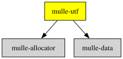

# mulle-utf

#### 🔤 UTF8-16-32 analysis and manipulation library

It is a C (C99) library to analyze and convert unicode strings. It also
contains some limited `<string.h>` like functionality for UTF16 and UTF32.
It is the backbone of **NSString**.


| Release Version                                       | Release Notes  | AI Documentation
|-------------------------------------------------------|----------------|---------------
|  [](//github.com/mulle-c/mulle-utf/actions)  | [RELEASENOTES](RELEASENOTES.md) | [DeepWiki for mulle-utf](https://deepwiki.com/mulle-c/mulle-utf)


## API

* [API Overview](asset/dox/api/toc)

| Documentation                          | Description                                      |
|----------------------------------------|--------------------------------------------------|
| [`mulle_char7`](dox/API_CHAR7.md)      | Encode small ASCII strings into integers         |
| [`mulle_char5`](dox/API_CHAR5.md)      | Encode some more smallish ASCII strings integers |
| [conversion](dox/API_CONVERSION.md)    | Character and string conversions                 |
| [information](dox/API_INFORMATION.md)  | Analyze and classify string encodings            |
| [string](dox/API_STRING.md)            | Primitive UTF16 and UTF32 string handling        |

For character type classification (`is_alphanumeric`, `is_whitespace`,
`tolower`, `toupper`, etc.) see
[mulle-unicode](//github.com/mulle-c/mulle-unicode).

`size_t` is used for byte-sized (really `char`-sized) lengths. UTF16 and
UTF32 use `size_t`.


### You are here




## Add

### Add mulle-utf via mulle-core

mulle-utf is a component of the
[mulle-core](//github.com/mulle-core/mulle-core) library.
In your code include its umbrella header:

``` c
#include <mulle-core/mulle-core.h>
```

In your project add mulle-core as a git submodule and link against it:

``` bash
git submodule add -f "https://github.com/mulle-core/mulle-core.git" \
                     "stash/mulle-core"
git submodule update --init --recursive
```

then add these comands to your `CMakeLists.txt`:

``` cmake
include_directories( SYSTEM "stash/mulle-core/src")
add_subdirectory( stash/mulle-core)
target_link_libraries( ${PROJECT_NAME} PUBLIC mulle-core)
```

Or let [mulle-sde](//github.com/mulle-sde) do it:

``` sh
mulle-sde add mulle-core/mulle-core
```


### Add mulle-utf as a cmake subproject

In your code include its header:

``` c
#include <mulle-utf/mulle-utf.h>
```

Add mulle-utf and dependencies as git submodules and link against
them:

``` bash
git submodule add -f --name "mulle-allocator" \
                            "https://github.com/mulle-c/mulle-allocator.git" \
                            "stash/mulle-allocator"
git submodule add -f --name "mulle-data" \
                            "https://github.com/mulle-c/mulle-data.git" \
                            "stash/mulle-data"
git submodule add -f --name "mulle-utf" \
                        "https://github.com/mulle-c/mulle-utf" \
                        "stash/mulle-utf"
git submodule update --init --recursive
```

``` cmake
include_directories( SYSTEM "${CMAKE_BINARY_DIR}/include")

add_subdirectory( stash/mulle-allocator)
add_subdirectory( stash/mulle-data)
add_subdirectory( stash/mulle-utf)

target_link_libraries( ${PROJECT_NAME} PUBLIC mulle-allocator)
target_link_libraries( ${PROJECT_NAME} PUBLIC mulle-data)
target_link_libraries( ${PROJECT_NAME} PUBLIC mulle-utf)
```

Or let [mulle-sde](//github.com/mulle-sde) do it:

``` sh
mulle-sde add github:mulle-c/mulle-utf
```

## Individual Install

Install all the prerequisites.

``` bash
PREFIX=/tmp/usr/local
BUILD_DIR="mulle-utf/build"

cmake -S "mulle-utf" -B "${BUILD_DIR}"    \
  -DCMAKE_BUILD_TYPE="Release"                  \
  -DCMAKE_INSTALL_PREFIX="${PREFIX}"            \
  -DCMAKE_PREFIX_PATH="${PREFIX}"               \
  -DCMAKE_C_FLAGS="-I"${PREFIX}"/include"       \
&& cmake --build "${BUILD_DIR}" &&              \
&& cmake --install "${BUILD_DIR}"
```


## Author

[Nat!](https://mulle-kybernetik.com/weblog) for Mulle kybernetiK  


